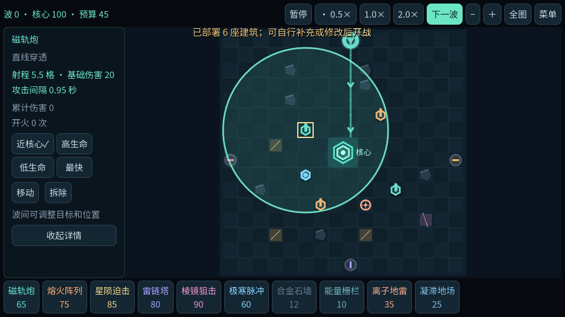

# 最后核心 · LAST CORE

Godot 4.5.2 制作的离线塔防游戏。Android 0.4.0 支持全图战场、暂停、拖放确认与炮台射程预览；所有进度和纪录保存在本机。

## 下载与预览

Windows 游戏包可在 [Releases](https://github.com/xizhi3002/last-core/releases) 下载。解压后运行 LastCore.exe。



## 开始游戏

现已增加 **Android 0.4.0 离线版**：支持横屏触控、单指拖动、双指缩放和后台自动保存暂停。安装与操作、构建方式及测试范围见 [Android 说明](docs/ANDROID.md)。Windows v0.1.0 下载仍保留在原版本发布中。

双击发行目录的 `LastCore.exe`，无需安装 Godot，也不依赖联网。

推荐第一局：部署新防线 → 选择 16×16 → 保留默认六蓝图 → 开始出征 → 拖出炮台并确认放置 → 开战。默认每 15 波停下来选择奖励；希望持续挂机可在设置中将自动奖励切为优先金币或优先强化。

- 五档地图：16×16、25×21、37×29、55×39、81×49，种子固定地形。
- 六种初始炮台、两种可解锁炮台、石墙/栅栏、伤害/减速陷阱。
- 四方向最短路径、特殊敌人路线、封路拒绝、破墙与自动重建。
- 高台、禁建通道、电离裂隙；点击炮台可在波间修改四种目标优先级。
- 每 5 波精英、每 15 波首领/成长选择，可选挑战在每周期第 9 波。
- 手机版 0.5/1/2 倍速（默认 0.5）、自动推进、永久研究、专精、进阶分支和模块。
- 波前存档与恢复、金币账本、结算、同种子重试、独立本地纪录。

## 桌面操作（手机版见 Android 说明）

| 操作 | 功能 |
|---|---|
| 左键 / 右键 | 建造 / 全额拆除 |
| 数字 1～6 | 选择携带炮台 |
| 滚轮 / 中键拖动 | 缩放 / 平移 |
| Shift + 左键框选 | 选中建筑 |
| M 后点击目标格 | 移动已选建筑；以选中数组第一座为锚点 |
| Delete | 拆除已选建筑 |
| 空格 | 开始波次 / 暂停 / 继续 |
| E / R / G / C | 编辑 / 路线 / 网格 / 回核心 |
| F11 / Esc | 全屏 / 菜单 |

战斗中不能改阵容；波间暂停时可以编辑。波间编辑停止倒计时，手机版确认编辑后手动点击“下一波”开战。陷阱可以通行，炮台与障碍阻路，必须保留全部入口通路。普通怪按最短路走，不因减速陷阱改变选择。

保存退出不结算出征；战斗中退出回滚到本波开始之前，已完成波次保留。关闭游戏不会产生离线收入。结束出征后，本局收入扣除商店消费后带回；里程碑奖励每档地图每 15 波首次发放一次。

存档目录：`%APPDATA%\Godot\app_userdata\最后核心 · LAST CORE\`。主档 `commander_local.json`，备份 `.bak`。不要在游戏运行中手动改存档。

## 验证状态

222 项核心检查通过；连续 60 波测试通过；20 组基础构筑完成 16 波；10 项磁盘结算/备份检查通过；UI 流程与原生导出程序存档测试通过。最大地图的实机短测与范围见 `docs/TEST_REPORT.md`，不能把这些检查解释为多小时稳定性或最终平衡验收。

## 开发与复现

源码已补充中文注释。初学者建议先阅读 [中文源码导读](docs/源码导读.md)，再按入口、战斗模拟、棋盘绘制、存档的顺序查看脚本。

引擎锁定 **Godot 4.5.2 stable**；渲染为 GL Compatibility，固定模拟步长 30 Hz。用 Godot 导入 `project.godot` 后按 F6/F5。规则与初始数值位于 `data/rules.json`。

```powershell
godot --headless --path . --script res://tests/test_simulation.gd
godot --headless --path . --script res://tests/test_storage.gd -- --test
godot --headless --path . --script res://tests/ui_smoke.gd -- --test
godot --headless --path . --script res://tests/balance.gd
godot --headless --path . --script res://tests/mobile_smoke.gd -- --mobile --test
godot --headless --path . --script res://tests/test_navigation.gd
```

Windows 导出：修改 `export_presets.cfg` 的 `custom_template/release` 为本机 4.5.2 的 Windows 模板，然后执行 `godot --headless --path . --export-release "Windows Desktop" build/LastCore.exe`。开发测试需要存在可写的 build 目录。

